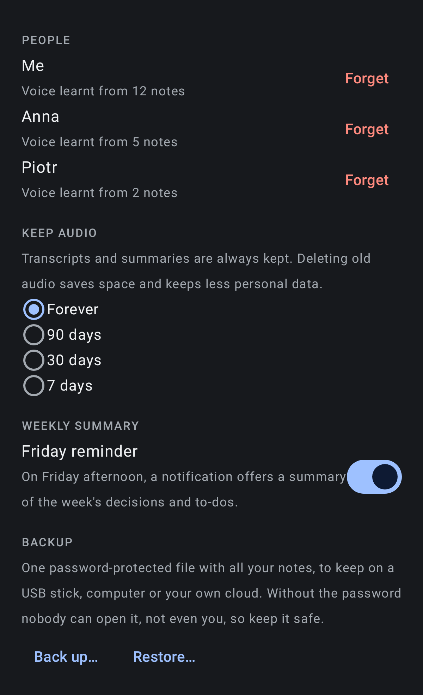

<p align="center"></p>

<h1 align="center">Sotto</h1>
<p align="center"><b>A private AI note taker for your watch</b></p>
<p align="center"><i>Sotto, from Italian <b>sotto voce</b> ("under the voice"): a quiet note taker that listens in the background and keeps everything on your devices.</i></p>

Sotto turns a Wear OS watch into an always-on, speech-only note taker.
The watch records when people talk. The phone turns each recording into a transcript with speakers, a summary and action items.
**Everything runs on your own devices. No account, no subscription, no cloud.**

Created by **Khayyam Bayramov** · [xayyam@gmail.com](mailto:xayyam@gmail.com) · Version 1.3

| Notes | A note | Watch control |
|---|---|---|
|  |  |  |

| Settings: people, audio, backup | Places | Watch app |
|---|---|---|
|  |  |  |

<sub>The screenshots show made-up sample notes. They are generated by `ScreenshotsTest` and `WatchScreenshotTest`, so you can run those tests again to refresh them. The Places map only appears on a real phone.</sub>

---

## What it does

**On the watch**
- Listens all day but **saves only speech**; silence is skipped.
- **Tile** shows live status, recording time and an estimate of the battery left (for example "~9 h battery"). Its buttons:
  - **Pause**: 15 min, 1 h or until resumed.
  - **Mark**: bookmarks an important moment.
  - **Note to self**: a short memo that arrives on the phone as a to-do.
  - **Forget**: deletes the last 5 min, 15 min or hour, on the watch and the phone.
- **Watch-face complication** shows Live / Paused / Off and today's minutes. Tap it to open Sotto.
- **Battery saver**: below 20 % Sotto skips the extra audio effects and syncs every 30 minutes instead of after every note.
- Sends recordings to the phone over a **direct Bluetooth/Wi-Fi link only**.
- Keeps recordings safely on the watch until the phone confirms it received them.

**Transcripts and speakers** (on the phone)
- **Transcription** with Parakeet v3, which is fast and accurate for English, Polish and 23 more European languages. Whisper turbo covers all other languages.
- **Speakers are found automatically**, sentence by sentence, so quick back-and-forth answers are split correctly. If the count is wrong, tap the right number on the note.
- **People**: tap a speaker (S1, S2) and say who it is ("Me", "Anna"). Sotto learns the voice on the phone and names that person in every note, summary and Ask answer.
- **Tap a line to play from that moment.** Marks from the watch are highlighted.
- **Progress on every note** ("Transcribing 42%", "Summarising…") and **Re-transcribe** with one tap.

**Summaries and follow-up**
- **AI summary and action items** for every note, made on the phone by Gemma.
- **Action items to your calendar or to-do app**: a calendar button and an "add to tasks" button on each item (Google Tasks, Todoist… via Share).
- **Summary of the day**: tap **⋮** next to a day for an overview, decisions, to-dos and people. It also works for any selection of notes.
- **Weekly summary**: a Friday-afternoon notification with the week's decisions and to-dos. It's also in the **⋮** menu.
- **Ask your notes**: ask a question about your conversations and get an answer with links to the notes it used.
- **Open in Claude / Gemini**: hands a note with a ready-made prompt to the official app, for a deeper analysis with your own subscription.

**Organising**
- **Notes** grouped by day or place, with search, filters, star, rename, delete with undo, multi-select and **Delete the day**.
- **Places**: a map of your notes. Rename a place once and every note there follows.
- **Export & share**: Markdown, PDF or text, to Gmail, Drive, Notion, NotebookLM, Files or any app.
- **Home-screen widget**: one-tap **Record** and your three latest notes.

**Recording on the phone**
- **Record with phone**: the phone's own mic (put it on the table) or a **headset mic**: Bluetooth, wired or USB.
- **Earbuds stay in music quality**: if music or Google Translate is using them, Sotto records with the phone's mic. If another app takes the mic, Sotto says so.
- **Watch tab**: watch status and battery, plus **Start / Stop / Pause** listening and **Sync now** from the phone.

**Privacy and safety**
- **Consent reminder** before recording starts.
- **App lock** with fingerprint, face or PIN.
- **Hide personal details when sharing**: e-mails, IBANs and phone, card or ID numbers become [email], [IBAN], [number].
- **Keep audio for 7, 30 or 90 days**: older audio is deleted and the text stays.
- **Encrypted backup**: one password-protected file (AES-256) with all notes, to restore on any phone.

## Requirements

| | Minimum |
|---|---|
| Phone | Android 12 or newer, 64-bit (almost every phone since ~2018), ~4 GB free for AI models |
| Watch | Wear OS 3 or newer with a microphone (Galaxy Watch4 and newer, Pixel Watch, TicWatch, OnePlus Watch…) |
| Not supported | Apple Watch, Garmin, older Tizen Galaxy watches |

The phone app also works **without a watch**, using **Record with phone**.

---

## Install

### 1. Phone
1. Copy **`Sotto-phone-1.3.apk`** to the phone (Drive, e-mail, USB cable…).
2. Open it. If Android asks, allow **Install unknown apps** for that app once.
3. Open **Sotto** and allow notifications, location (optional, for Places) and the microphone when asked.

### 2. Watch
A watch can't open an APK file directly, so it is installed from a computer once:
1. On the watch: **Settings → About watch → Software → tap "Software version" 5 times** to unlock Developer options.
2. **Settings → Developer options**: turn on **ADB debugging** and **Wireless debugging**. Tap **Pair new device** and note the IP, port and code.
3. On the computer, using Android platform-tools (`adb`):
   ```
   adb pair <watch-ip>:<pair-port>      # enter the code shown on the watch
   adb connect <watch-ip>:<port>
   adb install Sotto-watch-1.3.apk
   ```
4. Open **Sotto** on the watch, tap **Start** and allow the microphone and notifications.
5. Add the tile: swipe left on the watch face → **+** → **Sotto**.
6. Optional: add the complication. Long-press the watch face → **Edit** → **Complications** → pick a slot → **Sotto**.

### Updating (keeps your notes and AI models)
Install the new APK **over the old one; don't uninstall first**. Android keeps all notes and the downloaded models, because every Sotto release is signed with the same key.

If you do uninstall, Android asks **"Keep app data?"**. Tick it, and the notes and models are still there when you install Sotto again.

### 3. One-time AI setup (on the phone, Wi-Fi)
On the **Notes** screen, the **AI card** shows **Download**. It fetches the models once, about 3.1 GB:
- **Parakeet v3** for transcription: fast and accurate for English, Polish, Russian, Ukrainian, German, French and 19 more European languages. For other languages (such as Azerbaijani or Turkish), choose **Whisper turbo** in Settings. Russian and Ukrainian are handed to Whisper automatically when it is downloaded, because it hears them better on watch audio.
- **Speech detection** ([pyannote](https://github.com/pyannote/pyannote-audio) 3.0) and **voice fingerprints** ([3D-Speaker](https://github.com/modelscope/3D-Speaker) ERes2Net) to tell who is speaking
- **Gemma 4 E2B** for summaries and Ask; **E4B** in Settings is slower but better

Downloads continue in the background, over Wi-Fi only.

---

## Everyday use

| I want to… | Do this |
|---|---|
| Start listening | Watch tile → **Start**, or phone **Watch tab → Start listening** |
| Pause for a meeting break | Tile → **⏸** → 15 min / 1 h / until resumed |
| Remember an important moment | Tile → **🔖 Mark** (highlighted in the transcript) |
| Remind myself of something | Tile → **☑ Note to self**, say it, tap **Done**. It arrives on the phone as a note titled "To-do: …" |
| Take back something just said | Tile → **Forget last…** → 5 min / 15 min / 1 hour. The audio is deleted from the watch and the phone |
| Get the latest notes on the phone now | Phone Notes → **Sync**, or Watch tab → **Sync now** |
| Record a meeting with the phone | Notes → **Record with phone** → choose **Mic** (phone or headset) → **Start** → confirm everyone agreed |
| Process notes right away | AI card → **Now**. By default processing runs **while charging**. |
| Find something said last week | **Ask** tab, e.g. "What did I promise Anna?" |
| Send a note to someone | Open the note → **Share**, or long-press notes → **Export** |
| Summarise a day | Next to the day's name, **⋮ → Summary of the day** |
| Delete a day | **⋮ → Delete the day…** (Undo appears for a few seconds) |
| Teach Sotto who someone is | In a transcript, tap **S1/S2** → **Me** or a name |
| Record from the home screen | Long-press the home screen → **Widgets → Sotto**, then tap **● Record** |
| Send a summary to a client safely | Export → turn on **Hide personal details** |
| Back up everything | Settings → **Backup → Back up…**, choose a password and a place to save |
| Get a deeper analysis | Open the note → **Open in Claude** / **Open in Gemini** |

**Tip:** leave the phone on the charger overnight and every note of the day is transcribed and summarised by morning.

### Settings (gear on the AI card)
- **Transcription model:** Parakeet v3 (default when all your languages are supported) or Whisper turbo (all languages, slower).
- **Languages you speak:** transcription chooses only from these. The first one is the fallback.
- **Summary model** and **summaries in** (English or the recording's language).
- **Only while charging** (recommended).
- **Privacy:** App lock; Street names for places (off by default, see below); Consent reminder.
- **People:** voices Sotto knows, with **Forget**.
- **Keep audio:** forever, 90, 30 or 7 days.
- **Weekly summary:** Friday reminder on or off.
- **Backup:** **Back up…** and **Restore…** (password-protected file).
- **About:** version and author.

---

## Privacy

- Recordings, transcripts, summaries and places are stored **only on your phone and watch**.
- They are **excluded from Google backup** and from device-to-device transfer.
- Transcription and AI run **on the phone**. Nothing is uploaded unless **you** share a note.
- Watch → phone transfer uses a **direct connection only**, never Google's cloud relay.
- Location uses the phone's **own GPS only**. Places are named on the phone.
  **Street names** (Settings → Privacy) are optional; turning them on sends coordinates to Google's address lookup.
- **App lock** hides your notes from the recent-apps screen and the widget, and blocks screenshots.
- **Voice fingerprints** of people you name are stored only on the phone; **Forget** deletes them.
- **Backups** are encrypted with your password (AES-256-GCM, PBKDF2). Sotto never uploads them.
- **Hide personal details** removes e-mails, IBANs and long numbers from anything you share.
- **Network use (none of it personal):**
  - One-time model downloads from GitHub and Hugging Face.
  - Map images from OpenFreeMap; they can see which map area is on screen.

## Troubleshooting

| Problem | Fix |
|---|---|
| New notes don't appear | Tap **Sync**. Check that the watch shows "Connected" and that **Show all** isn't hiding notes. |
| Watch says "Phone out of reach" | Recordings stay safe on the watch and sync when the phone is back nearby. |
| "Start listening" from the phone shows a prompt on the watch | Android lets only the watch itself switch its microphone on after a restart. Tap **Start** once on the watch. |
| Notes not transcribed | Models downloaded? Phone charging (or tap **Now**)? |
| Two people, but only S1 | Open the note and tap **Speakers → 2**. Speaker labels are per note; S1 in one note isn't necessarily S1 in another. |
| Music or Google Translate in my earbuds while recording | Earbud mics only work in "call mode", which lowers music to call quality and competes with Translate for the mic. If the earbuds are busy when you start, Sotto records with the phone's mic instead. If another app takes the mic, Sotto pauses and says so. Best: record with the **watch**, which has its own mic. |
| Models download again after reinstalling | Install updates over the old app instead of uninstalling (see *Updating*). |
| Tile shows "Battery saver" | The watch is below 20 %. Sotto keeps listening but syncs every 30 minutes. Charge the watch to return to normal. |
| Lots of "Unknown place" | Allow location **all the time**. GPS may not get a fix indoors. |

---

## For developers

- Project: Android Studio, Kotlin 2.4, Jetpack Compose. Modules: `app` (Wear OS) and `mobile` (phone). Both use applicationId `com.example.watchscribe`.
- Tests:
  - `SottoLogicTest` (phone) and `WatchLogicTest` (watch) check the logic.
  - `ScreenshotsTest` and `WatchScreenshotTest` regenerate `docs/screens`.
  - Run all of them with `./gradlew :mobile:testDebugUnitTest :app:testDebugUnitTest`.
- Release build: **Build → Build App Bundle(s) / APK(s) → Build APK(s)** with the *release* variant.
  It is signed with `sotto-release.jks` + `keystore.properties`.
  **Keep both private and backed up.** Updates must use the same key.
- Key libraries:
  - [sherpa-onnx](https://github.com/k2-fsa/sherpa-onnx) for Parakeet, Whisper and speaker detection
  - [LiteRT-LM](https://github.com/google-ai-edge/LiteRT-LM) for Gemma
  - [MapLibre](https://maplibre.org) with [OpenFreeMap](https://openfreemap.org) for the map
- AI models are downloaded from their publishers and keep their own licenses: Parakeet v3 (NVIDIA, CC-BY-4.0), Whisper (OpenAI, MIT), pyannote segmentation 3.0 (MIT), 3D-Speaker ERes2Net (Apache-2.0) and Gemma (Google, Gemma terms).

## License

Sotto is free for **personal and other noncommercial use** under the [PolyForm Noncommercial License 1.0.0](LICENSE).
For commercial use, contact [xayyam@gmail.com](mailto:xayyam@gmail.com).

© 2026 Khayyam Bayramov
