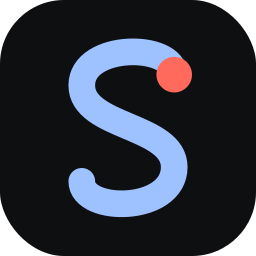
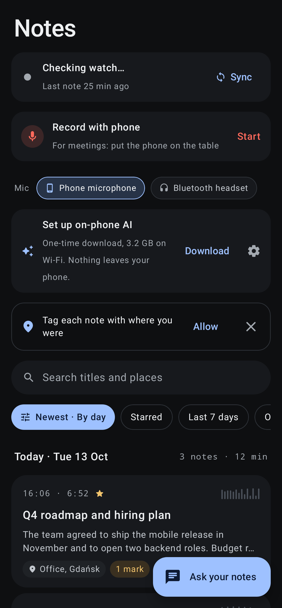
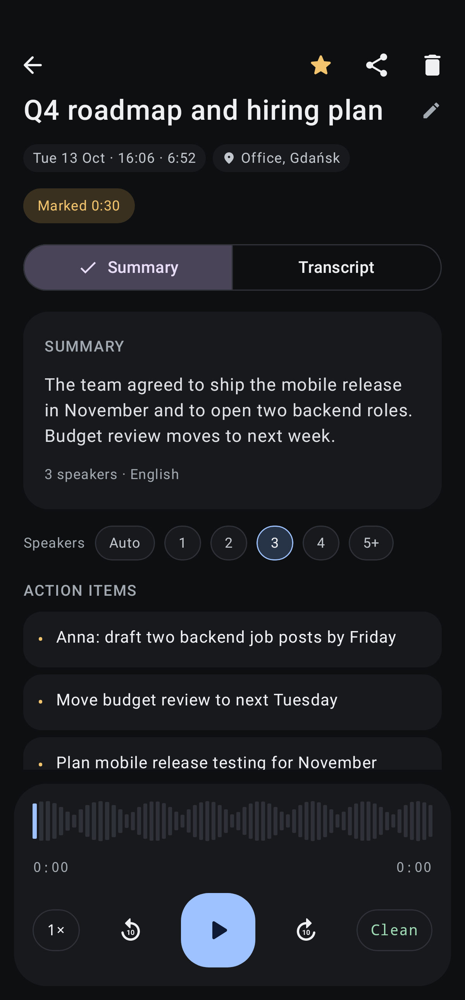
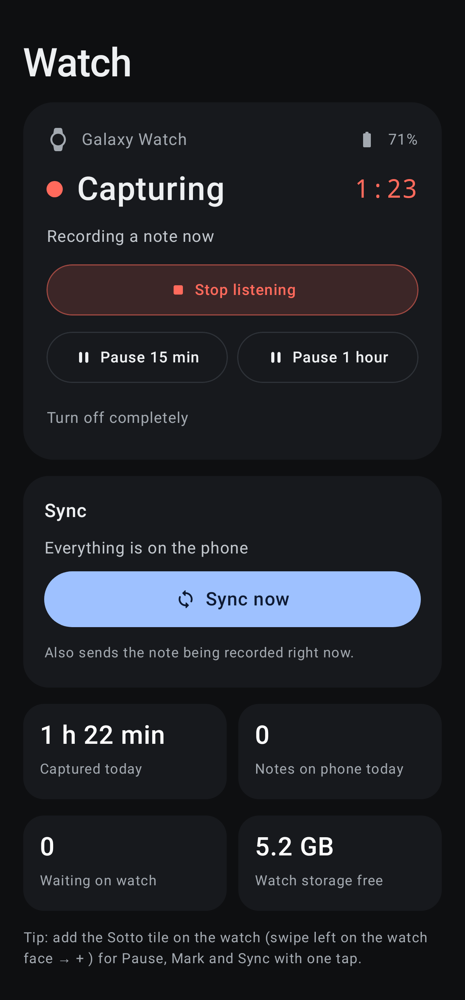
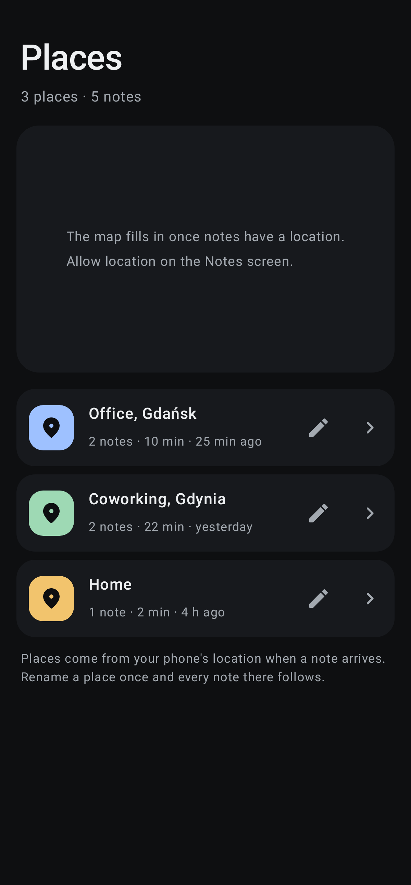
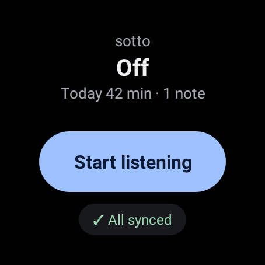

<p align="center"></p>

<h1 align="center">Sotto</h1>
<p align="center"><b>A private AI note taker for your watch</b></p>

Sotto turns a Wear OS watch into an always-on, speech-only note taker.
The watch records when people talk. The phone turns each recording into a transcript with speakers, a summary and action items.
**Everything runs on your own devices. No account, no subscription, no cloud.**

Created by **Khayyam Bayramov** · [xayyam@gmail.com](mailto:xayyam@gmail.com) · Phone app 1.1 · Watch app 1.0

| Notes | A note | Watch control |
|---|---|---|
|  |  |  |

| Places | Watch app |
|---|---|
|  |  |

<sub>The screenshots show made-up sample notes. They are generated by `ScreenshotsTest` and `WatchScreenshotTest`, so you can run those tests again to refresh them. The Places map only appears on a real phone.</sub>

---

## What it does

**On the watch**
- Listens all day but **saves only speech**; silence is skipped.
- **Tile** on the watch face shows live status and recording time. It also has **Pause** (15 min, 1 h or until resumed), **Mark** (bookmark an important moment) and **Sync**.
- Sends recordings to the phone over a **direct Bluetooth/Wi-Fi link only**.
- Keeps recordings safely on the watch until the phone confirms it received them.

**On the phone**
- **Notes**: all recordings, grouped by day or place, with search, filters, star, rename, delete (with undo) and multi-select.
- **Transcripts with speakers** (S1, S2…). Tap a line to play from that moment. Marks from the watch are highlighted.
  The number of people is found automatically. If it's wrong, tap the right number on the note.
- **Progress on every note**: "Transcribing 42%" and "Summarising…" show on the note itself.
- **Re-transcribe** any note with one tap, for example after changing languages.
- **AI summary and action items** for every note, made on the phone by Gemma.
- **Ask your notes**: ask a question about your conversations and get an answer with links to the notes it used.
- **Places**: a map with your notes by location. Rename a place once and every note there follows.
- **Watch tab**: watch status, battery, notes waiting, **Start/Stop/Pause** listening from the phone and **Sync now**.
- **Record with phone**: record with the phone's own microphone (put it on the table) or with a **headset mic**: Bluetooth (earbuds, AirPods…), wired or USB.
- **Export & share**: Markdown, PDF or text, to Gmail, Drive, Notion, NotebookLM, Files, or any app.
- **Open in Claude / Gemini**: hands a note with a ready-made prompt to the official app, so your own subscription can analyse it.
- **App lock** with fingerprint, face or PIN.
- **Consent reminder** before recording starts: tell people and get their OK.

## Requirements

| | Minimum |
|---|---|
| Phone | Android 12 or newer, 64-bit (almost every phone since ~2018), ~4 GB free for AI models |
| Watch | Wear OS 3 or newer with a microphone (Galaxy Watch4 and newer, Pixel Watch, TicWatch, OnePlus Watch…) |
| Not supported | Apple Watch, Garmin, older Tizen Galaxy watches |

The phone app also works **without a watch**, using **Record with phone**.

---

## Install

### 1. Phone
1. Copy **`Sotto-phone-1.1.apk`** to the phone (Drive, e-mail, USB cable…).
2. Open it. If Android asks, allow **Install unknown apps** for that app once.
3. Open **Sotto** and allow notifications, location (optional, for Places) and the microphone when asked.

### 2. Watch
A watch can't open an APK file directly, so it is installed from a computer once:
1. On the watch: **Settings → About watch → Software → tap "Software version" 5 times** to unlock Developer options.
2. **Settings → Developer options**: turn on **ADB debugging** and **Wireless debugging**. Tap **Pair new device** and note the IP, port and code.
3. On the computer, using Android platform-tools (`adb`):
   ```
   adb pair <watch-ip>:<pair-port>      # enter the code shown on the watch
   adb connect <watch-ip>:<port>
   adb install Sotto-watch-1.0.apk
   ```
4. Open **Sotto** on the watch, tap **Start** and allow the microphone and notifications.
5. Add the tile: swipe left on the watch face → **+** → **Sotto**.

### Updating (keeps your notes and AI models)
Install the new APK **over the old one; don't uninstall first**. Android keeps all notes and the downloaded models, because every Sotto release is signed with the same key.

If you do uninstall, Android asks **"Keep app data?"**. Tick it, and the notes and models are still there when you install Sotto again.

> Coming from an early test build (before 1.0), signed with a different key? Then one uninstall is unavoidable. **Export your notes first.**

### 3. One-time AI setup (on the phone, Wi-Fi)
On the **Notes** screen, the **AI card** shows **Download**. It fetches the models once, about 3.2 GB:
- **Whisper turbo** for transcription
- **Speaker detection** to tell who is speaking
- **Gemma 4 E2B** for summaries and Ask; **E4B** in Settings is slower but better

Downloads continue in the background, over Wi-Fi only.

---

## Everyday use

| I want to… | Do this |
|---|---|
| Start listening | Watch tile → **Start**, or phone **Watch tab → Start listening** |
| Pause for a meeting break | Tile → **⏸** → 15 min / 1 h / until resumed |
| Remember an important moment | Tile → **🔖 Mark** (highlighted in the transcript) |
| Get the latest notes on the phone now | Phone Notes → **Sync**, or Watch tab → **Sync now** |
| Record a meeting with the phone | Notes → **Record with phone** → choose **Mic** (phone or headset) → **Start** → confirm everyone agreed |
| Process notes right away | AI card → **Now**. By default processing runs **while charging**. |
| Find something said last week | **Ask** tab, e.g. "What did I promise Anna?" |
| Send a note to someone | Open the note → **Share**, or long-press notes → **Export** |
| Get a deeper analysis | Open the note → **Open in Claude** / **Open in Gemini** |

**Tip:** leave the phone on the charger overnight and every note of the day is transcribed and summarised by morning.

### Settings (gear on the AI card)
- **Languages you speak:** transcription chooses only from these. The first one is the fallback.
- **Summary model** and **summaries in** (English or the recording's language).
- **Only while charging** (recommended).
- **Privacy:** App lock; Street names for places (off by default, see below); Consent reminder.
- **About:** version and author.

---

## Privacy

- Recordings, transcripts, summaries and places are stored **only on your phone and watch**.
- They are **excluded from Google backup** and from device-to-device transfer.
- Transcription and AI run **on the phone**. Nothing is uploaded unless **you** share a note.
- Watch → phone transfer uses a **direct connection only**, never Google's cloud relay.
- Location uses the phone's **own GPS only**. Places are named on the phone.
  **Street names** (Settings → Privacy) are optional; turning them on sends coordinates to Google's address lookup.
- **App lock** hides your notes from the recent-apps screen and blocks screenshots.
- **Network use (none of it personal):**
  - One-time model downloads from GitHub and Hugging Face.
  - Map images from OpenFreeMap; they can see which map area is on screen.

## Troubleshooting

| Problem | Fix |
|---|---|
| New notes don't appear | Tap **Sync**. Check that the watch shows "Connected" and that **Show all** isn't hiding notes. |
| Watch says "Phone out of reach" | Recordings stay safe on the watch and sync when the phone is back nearby. |
| "Start listening" from the phone shows a prompt on the watch | Android lets only the watch itself switch its microphone on after a restart. Tap **Start** once on the watch. |
| Notes not transcribed | Models downloaded? Phone charging (or tap **Now**)? |
| Two people, but only S1 | Open the note and tap **Speakers → 2**. Speaker labels are per note; S1 in one note isn't necessarily S1 in another. |
| Models download again after reinstalling | Install updates over the old app instead of uninstalling (see *Updating*). |
| Lots of "Unknown place" | Allow location **all the time**. GPS may not get a fix indoors. |

---

## For developers

- Project: Android Studio, Kotlin 2.4, Jetpack Compose. Modules: `app` (Wear OS) and `mobile` (phone). Both use applicationId `com.example.watchscribe`.
- Tests:
  - `SottoLogicTest` (phone) and `WatchLogicTest` (watch) check the logic.
  - `ScreenshotsTest` and `WatchScreenshotTest` regenerate `docs/screens`.
  - Run all of them with `./gradlew :mobile:testDebugUnitTest :app:testDebugUnitTest`.
- Release build: **Build → Build App Bundle(s) / APK(s) → Build APK(s)** with the *release* variant.
  It is signed with `sotto-release.jks` + `keystore.properties`.
  **Keep both private and backed up.** Updates must use the same key.
- Key libraries:
  - [sherpa-onnx](https://github.com/k2-fsa/sherpa-onnx) for Whisper and speaker detection
  - [LiteRT-LM](https://github.com/google-ai-edge/LiteRT-LM) for Gemma
  - [MapLibre](https://maplibre.org) with [OpenFreeMap](https://openfreemap.org) for the map

## License

Sotto is free for **personal and other noncommercial use** under the [PolyForm Noncommercial License 1.0.0](LICENSE).
For commercial use, contact [xayyam@gmail.com](mailto:xayyam@gmail.com).

© 2026 Khayyam Bayramov
